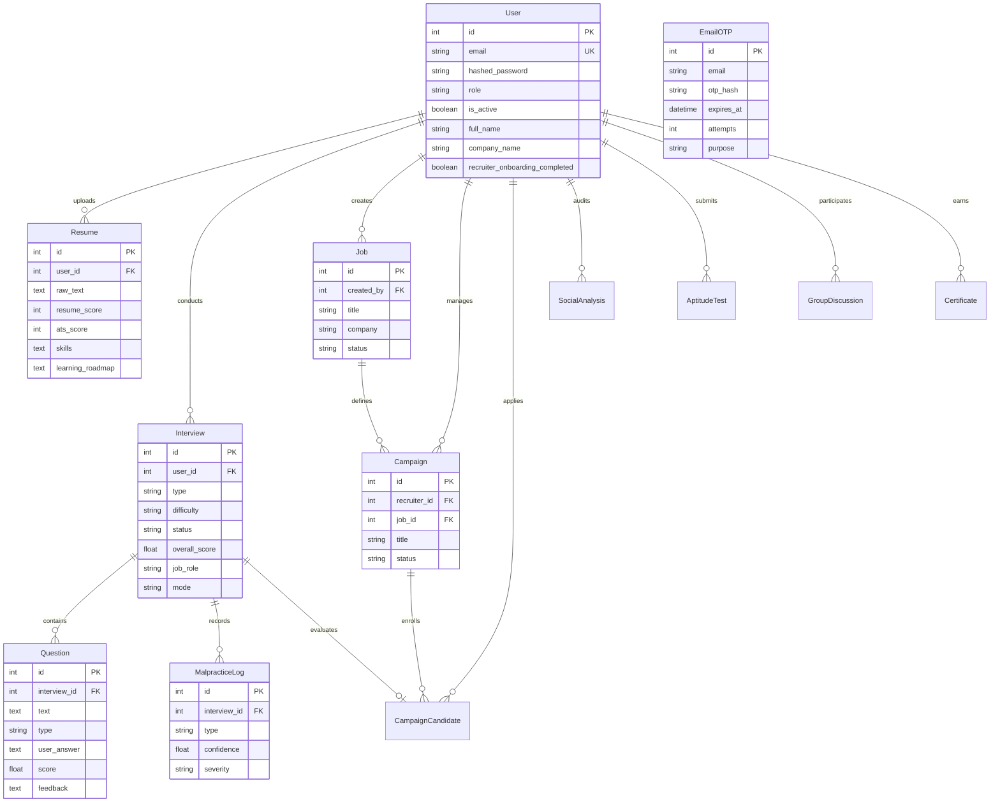
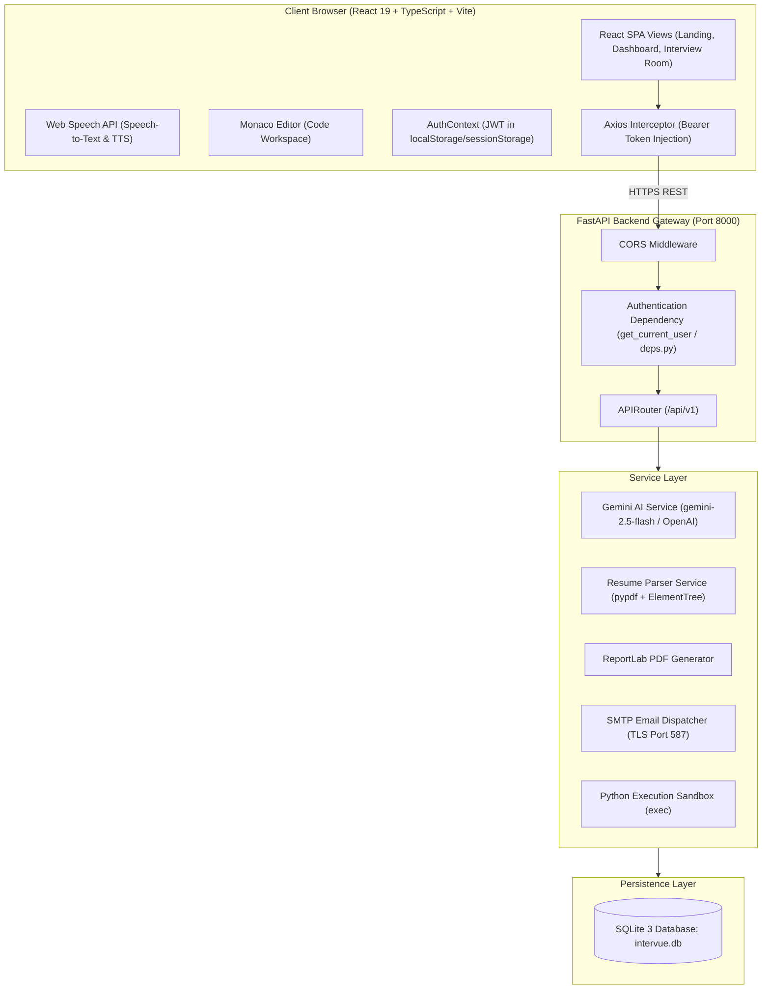
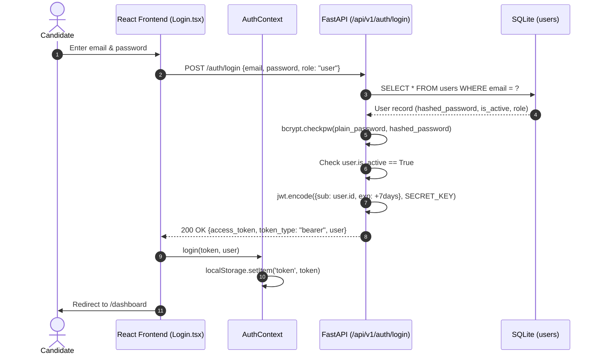
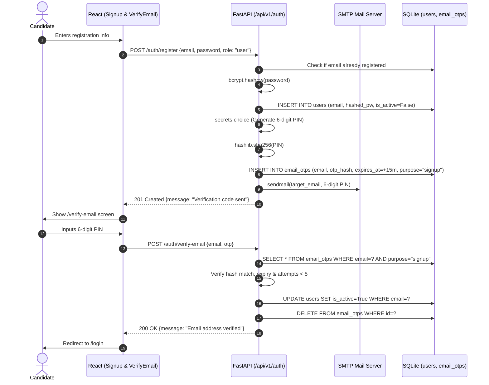
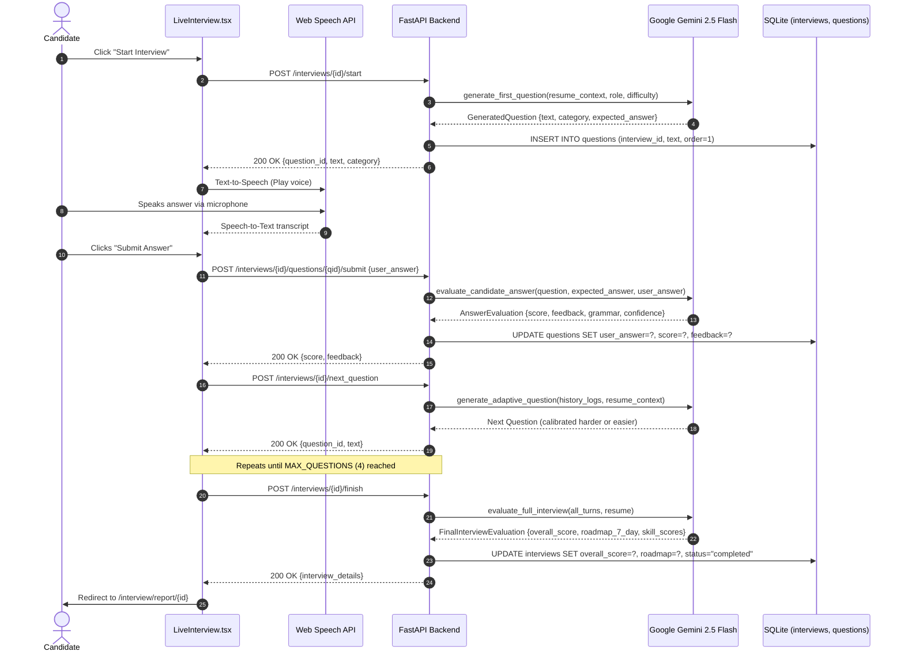

# INTERVUEAI — COMPLETE TECHNICAL AUDIT REPORT
**Comprehensive System Architecture, Full-Stack Implementation, Security, Database, and Technical Interview Evaluation**

---

> **Audit Date:** October 30, 2026  
> **Repository:** `kandukurisrikar077/AI-Interview-Simulator`  
> **Project Name:** IntervueAI — AI Interview Simulator  
> **Auditor Role:** Senior Software Architect, Full-Stack Engineer, Security Auditor & Technical Mentor  
> **Audit Type:** Full Read-Only Codebase Inspection & Verification  

---

## TABLE OF CONTENTS
1. [Executive Summary](#executive-summary)
2. [Phase 1 — Project Location and Directory Structure](#phase-1--project-location-and-directory-structure)
3. [Phase 2 — Complete Technology Stack Audit](#phase-2--complete-technology-stack-audit)
4. [Phase 3 — Complete Frontend Review](#phase-3--complete-frontend-review)
5. [Phase 4 — Complete Backend Review](#phase-4--complete-backend-review)
6. [Phase 5 — Database Audit](#phase-5--database-audit)
7. [Phase 6 — Authentication and Security Audit](#phase-6--authentication-and-security-audit)
8. [Phase 7 — AI Functionality Audit](#phase-7--ai-functionality-audit)
9. [Phase 8 — Feature-by-Feature Audit](#phase-8--feature-by-feature-audit)
10. [Phase 9 — System Architecture & Data Flow Diagrams](#phase-9--system-architecture--data-flow-diagrams)
11. [Phase 10 — Testing and Quality Review](#phase-10--testing-and-quality-review)
12. [Phase 11 — Deployment and DevOps Review](#phase-11--deployment-and-devops-review)
13. [Phase 12 — Architectural Decisions and Alternatives](#phase-12--architectural-decisions-and-alternatives)
14. [Phase 13 — Resume Accuracy Review](#phase-13--resume-accuracy-review)
15. [Phase 14 — Interview Preparation Guide & Defense Strategy](#phase-14--interview-preparation-guide--defense-strategy)

---

## EXECUTIVE SUMMARY

| Attribute | Verified Value / Finding |
| :--- | :--- |
| **Exact Project Path** | `D:\projects\AI Interview Simulator` |
| **Active Git Branch** | `main` |
| **Latest Git Commit** | `3bcce23` — *"Add signup email verification OTP"* (2026-09-02) |
| **Working Tree Status** | Clean (0 uncommitted changes) |
| **Frontend Framework** | React 19.2.7 + TypeScript ~6.0.2 + Vite 8.1.0 + Tailwind CSS 4.3.2 |
| **Backend Framework** | FastAPI 0.115+ (Python 3.11/3.14) + Uvicorn 0.30+ |
| **Actual Database Engine** | **SQLite 3** (`intervue.db` committed in repo; default `sqlite:///./intervue.db`) |
| **PostgreSQL Status** | **NOT IMPLEMENTED / NOT INSTALLED** (Drivers absent in `requirements.txt`) |
| **Authentication Engine** | JWT (`python-jose` HS256) + direct `bcrypt` password hashing + 6-digit Email OTP |
| **AI LLM Engine** | Google GenAI SDK (`gemini-2.5-flash`) with fallback to OpenAI (`gpt-4o-mini`) & static mocks |
| **Registered REST APIs** | **60 Endpoints** across 10 router modules under `/api/v1` (plus root `/`) |
| **Frontend Architecture** | 43 Pages, 12 Reusable UI Components, React Router v7, Axios Interceptors |
| **Critical Security Issue** | **Arbitrary Code Execution (RCE)** in `backend/app/api/v1/coding.py` via un-sandboxed `exec()` |
| **Live Deployment Status** | **OFFLINE** (Vercel returns `DEPLOYMENT_NOT_FOUND`; Render backend returns 404) |
| **Test Suite Coverage** | **0% Formal Tests** (No Jest/Vitest; no Pytest test suite; only 4 scratch scripts) |
| **Overall Project Maturity** | **Advanced MVP / Working Prototype** (75% functional, 20% mocked, 5% dead/unsafe) |

---

# PHASE 1 — PROJECT LOCATION AND DIRECTORY STRUCTURE

### 1.1 Discovery & Repository Verification
During the initial repository discovery phase, workspace investigation revealed:
1. `D:\projects\AGENTS` contained only a standalone Google ADK prototype (`my_first_agent`).
2. `D:\projects\AI Interview Simulator` existed as an empty directory created on September 21, 2026.
3. The official remote repository was identified as `https://github.com/kandukurisrikar077/AI-Interview-Simulator.git` (commit `3bcce234497e282fea64d17a935427d30ecc2bf1`).
4. The repository was cleanly cloned into `D:\projects\AI Interview Simulator` to conduct this comprehensive audit without altering any code files or external infrastructure.

### 1.2 Git Repository Metadata
- **Absolute Path:** `D:\projects\AI Interview Simulator`
- **Repository Name:** `AI-Interview-Simulator` (Project Title: `IntervueAI`)
- **Remote Origin URL:** `https://github.com/kandukurisrikar077/AI-Interview-Simulator.git`
- **Active Branch:** `main`
- **Latest Commit Hash:** `3bcce234497e282fea64d17a935427d30ecc2bf1` (Short: `3bcce23`)
- **Latest Commit Message:** `Add signup email verification OTP`
- **Latest Commit Date:** September 2, 2026
- **Working Tree:** Clean, 0 uncommitted changes.

### 1.3 Complete Directory Tree
```text
D:\projects\AI Interview Simulator\
├── .env.example                               # Environment variable blueprint
├── .gitignore                                 # Git ignore definitions
├── docker-compose.yml                         # Multi-container orchestration specification
├── README.md                                  # Top-level platform overview
│
├── docs/                                      # Technical documentation suite
│   ├── API.md                                 # REST API specification
│   ├── ARCHITECTURE.md                        # Architecture & flow descriptions
│   ├── DEPLOYMENT.md                          # Production deployment guidelines
│   └── INSTALL.md                             # Local developer installation guide
│
├── backend/                                   # FastAPI Python Backend Root
│   ├── clean_db.py                            # Database reset & admin re-seeding utility
│   ├── Dockerfile                             # Python 3.11-slim container specification
│   ├── intervue.db                            # SQLite 3 database file (140 KB, 14 tables)
│   ├── migrate_now.py                         # Standalone imperative SQLite schema migration script
│   ├── package-lock.json                      # Stale legacy lock file (unused)
│   ├── requirements.txt                       # Backend Python dependencies
│   ├── run.py                                 # Local development Uvicorn runner
│   ├── test_persistence.py                    # Verification script for DB persistence
│   │
│   ├── app/                                   # Application Source Package
│   │   ├── main.py                            # FastAPI app entry point, CORS, startup migrations & seeders
│   │   │
│   │   ├── api/                               # API Routing Layer
│   │   │   ├── deps.py                        # Dependency injection (DB session, JWT auth & Admin guards)
│   │   │   └── v1/                            # API Version 1 Routers
│   │   │       ├── admin.py                   # Admin dashboard statistics & DB reset
│   │   │       ├── analytics.py               # User analytics, score history & breakdowns
│   │   │       ├── api.py                     # Aggregated APIRouter registration hub
│   │   │       ├── auth.py                    # User registration, login, JWT token & Email OTP handlers
│   │   │       ├── coding.py                  # Coding challenge generation & sandbox runner
│   │   │       ├── interviews.py              # Mock interview lifecycle, question transitions & report generation
│   │   │       ├── placement.py               # Resume builder, cover letters, GD & aptitude endpoints
│   │   │       ├── questions.py               # Question bank CRUD operations
│   │   │       ├── recruiter.py               # Jobs, campaigns, onboarding & candidate pipeline
│   │   │       ├── resumes.py                 # Resume upload & AI-assisted extraction
│   │   │       └── users.py                   # Admin user management (suspend, role toggle, reset)
│   │   │
│   │   ├── core/                              # Core Framework Foundation
│   │   │   ├── config.py                      # Pydantic Settings configuration & env loading
│   │   │   ├── database.py                    # SQLAlchemy Engine, SessionLocal & declarative Base
│   │   │   └── security.py                    # Bcrypt password hashing & JWT encoding utilities
│   │   │
│   │   ├── models/                            # Database Entity Models
│   │   │   └── models.py                      # 14 SQLAlchemy Declarative Models
│   │   │
│   │   ├── schemas/                           # Validation Schemas
│   │   │   └── schemas.py                     # 27 Pydantic v2 Request/Response DTO models
│   │   │
│   │   └── services/                          # Business Logic & External Integrations
│   │       ├── email_service.py               # SMTP email dispatcher with development mock fallback
│   │       ├── gemini.py                      # Google GenAI / OpenAI adaptive interview & scoring service
│   │       ├── placement_ai.py                # AI assistance for cover letters, GD, and social profiles
│   │       ├── report_generator.py            # ReportLab PDF evaluation report generator
│   │       └── resume_parser.py               # PDF/DOCX extraction & ATS evaluation engine
│   │
│   └── scratch/                               # Temporary developer test scripts
│       ├── register_test.py
│       ├── register_unique_test.py
│       └── test_db_columns.py
│
└── frontend/                                  # Vite + React + TypeScript Frontend Root
    ├── index.html                             # Single Page Application HTML shell
    ├── nginx.conf                             # Nginx SPA fallback configuration for Docker
    ├── package.json                           # Frontend NPM dependencies & scripts
    ├── package-lock.json                      # NPM deterministic dependency tree
    ├── postcss.config.js                      # PostCSS plugins (Tailwind CSS)
    ├── tailwind.config.js                     # Tailwind CSS styling design system configuration
    ├── tsconfig.app.json                      # TypeScript compiler configuration for client app
    ├── tsconfig.json                          # TypeScript project reference root
    ├── tsconfig.node.json                     # TypeScript compiler configuration for Vite tooling
    ├── vercel.json                            # Vercel deployment SPA rewrite rule
    ├── vite.config.ts                         # Vite bundler plugins and aliases
    ├── .env.production                        # Production API URL configuration
    │
    └── src/                                   # Frontend TypeScript Source Code
        ├── App.tsx                            # Root application component & React Router v7 routes
        ├── main.tsx                           # React 19 DOM bootstrap mounting point
        ├── index.css                          # Global design system & Tailwind directives
        │
        ├── components/                        # UI Component Library
        │   ├── common/                        # Common Shared Components
        │   │   ├── Breadcrumbs.tsx            # Navigation breadcrumb trails
        │   │   └── ErrorBoundary.tsx          # React error boundary (Dead/Unused component)
        │   ├── layout/                        # Structure & Layout Wrappers
        │   │   ├── AdminLayout.tsx            # Admin dashboard sidebar & header chrome
        │   │   └── Sidebar.tsx                # Candidate portal navigation sidebar
        │   └── ui/                            # Reusable Design System Primitives
        │       ├── Badge.tsx                  # Status pill badges
        │       ├── Button.tsx                 # Styled interactive action buttons
        │       ├── Card.tsx                   # Content cards with frosted-glass border styles
        │       ├── Checkbox.tsx               # Controlled checkbox inputs
        │       ├── Dialog.tsx                 # Modal dialogs & confirm drawers
        │       ├── EmptyState.tsx             # Placeholder cards when data is empty
        │       ├── Input.tsx                  # Standard form input fields
        │       ├── LoadingSpinner.tsx         # SVG spinner primitive (Dead/Unused component)
        │       ├── PasswordInput.tsx          # Password toggle input with reveal button
        │       ├── Select.tsx                 # Dropdown selection input
        │       ├── SkeletonLoader.tsx         # Loading skeleton pulse placeholders
        │       ├── Table.tsx                  # Tabular data grid wrappers
        │       └── Tabs.tsx                   # Tab switching primitives
        │
        ├── context/                           # React State Contexts
        │   ├── AuthContext.tsx                # Global user authentication & role state
        │   └── ToastContext.tsx               # Global notification toast provider
        │
        ├── hooks/                             # Custom React Hooks
        │   ├── useApi.ts                      # Generic async API wrapper (Dead/Unused)
        │   └── useBrowserIntegrity.ts         # Proctoring hook (Dead/Unused; logic copied in page)
        │
        ├── pages/                             # 43 Page Components
        │   ├── Achievements.tsx               # Badges, milestone unlocks & certificate display
        │   ├── Analytics.tsx                  # Candidate score graphs & skill breakdown
        │   ├── Aptitude.tsx                   # Quantitative/logical MCQ test arena
        │   ├── CertificatesList.tsx           # Verification codes & certificate PDF downloads
        │   ├── CodingRound.tsx                # Monaco code editor, test runner & challenge interface
        │   ├── CompanyInterviews.tsx          # Company-specific mock track cards (UI mock)
        │   ├── CoverLetter.tsx                # AI cover letter generator & PDF export
        │   ├── Dashboard.tsx                  # Candidate central command center
        │   ├── ErrorPage.tsx                  # Unified 401, 403, 404, 500 & offline error view
        │   ├── ForgotPassword.tsx             # Password recovery request form
        │   ├── GroupDiscussion.tsx            # AI multi-bot group discussion simulation
        │   ├── HelpCenter.tsx                 # Knowledge base & FAQs (Static UI)
        │   ├── History.tsx                    # Past interview transcripts & report archive
        │   ├── HrSimulator.tsx                # Behavioral HR simulator (Mock/Client-only)
        │   ├── Landing.tsx                    # Platform landing page & feature showcases
        │   ├── LiveInterview.tsx              # Audio/video speech recognition interview room
        │   ├── Login.tsx                      # Candidate email/password and OTP login
        │   ├── Profile.tsx                    # User personal details, academic history & API keys
        │   ├── Report.tsx                     # Post-interview evaluation breakdown & PDF report
        │   ├── ResetPassword.tsx              # Password reset confirmation form
        │   ├── Resume.tsx                     # Resume upload, ATS score & roadmap analysis
        │   ├── ResumeBuilder.tsx              # Interactive resume builder with AI suggestions
        │   ├── Roadmap.tsx                    # 7-day and 30-day adaptive learning milestones
        │   ├── Settings.tsx                   # Account preferences, password change & deletion
        │   ├── Setup.tsx                      # Interview configuration (Role, Difficulty, Duration)
        │   ├── Signup.tsx                     # Candidate registration form
        │   ├── SocialAnalyzer.tsx             # LinkedIn & GitHub profile review interface
        │   ├── Subscription.tsx               # Pricing tier cards & mock upgrade dialog
        │   ├── VerifyEmail.tsx                # Candidate 6-digit email OTP verification view
        │   ├── WorkspaceSelect.tsx            # Portal selector (Candidate vs Recruiter)
        │   │
        │   ├── admin/                         # Administrator Portal
        │   │   ├── AdminDashboard.tsx         # User tables, interview logs, stats, DB reset
        │   │   └── AdminLogin.tsx             # Administrative portal login gate
        │   │
        │   └── recruiter/                     # Recruiter Portal
        │       ├── CandidatePipeline.tsx      # Kanban candidate application tracking
        │       ├── CreateJob.tsx              # Job requisition posting form
        │       ├── HiringCampaigns.tsx        # Campaign creation with interview criteria
        │       ├── QuestionBank.tsx           # Technical & HR question repository
        │       ├── RecruiterDashboard.tsx     # Recruiter metrics & quick actions
        │       ├── RecruiterLogin.tsx         # Dedicated recruiter authentication gate
        │       ├── RecruiterOnboarding.tsx    # Multi-step company profile setup wizard
        │       ├── RecruiterReports.tsx       # Candidate interview evaluation summaries
        │       ├── RecruiterSettings.tsx      # Company profile & preference editor
        │       ├── RecruiterSignup.tsx        # Recruiter registration form
        │       └── TeamInvite.tsx             # Recruiter team member invitation form (UI mock)
        │
        ├── services/                          # Frontend HTTP Client Layer
        │   ├── adminService.ts                # API client calls for admin operations
        │   ├── analyticsService.ts            # API client call for candidate analytics
        │   ├── api.ts                         # Central Axios instance with JWT interceptors
        │   ├── interviewService.ts            # API client calls for interview lifecycle
        │   ├── resumeService.ts               # Dead/Unused service (bypassed by direct calls)
        │   └── userService.ts                 # API client calls for user profile updates
        │
        ├── types/                             # TypeScript Interface Declarations
        │   └── api.ts                         # Complete DTO typing for API requests & responses
        │
        └── utils/                             # Utilities & Mock Databases
            └── mockData.ts                    # LocalStorage mock store for admin-only features
```

---

# PHASE 2 — COMPLETE TECHNOLOGY STACK AUDIT

### 2.1 Complete Technology Inventory Table

| Technology | Category | Exact Version | Where Used | Purpose | Evidence | Status |
| :--- | :--- | :--- | :--- | :--- | :--- | :--- |
| **React** | Frontend Library | `^19.2.7` | `frontend/package.json` | Core UI component lifecycle rendering | `package.json`, `main.tsx` | **VERIFIED (Active)** |
| **TypeScript** | Language Tooling | `~6.0.2` | `frontend/package.json` | Static type safety across frontend code | `tsconfig.json`, `src/**/*.tsx` | **VERIFIED (Active)** |
| **Vite** | Frontend Bundler | `^8.1.0` | `frontend/package.json` | Fast HMR dev server & production bundling | `vite.config.ts`, `package.json` | **VERIFIED (Active)** |
| **Tailwind CSS** | Styling System | `^4.3.2` | `frontend/package.json` | Utility-first responsive dark theme design | `tailwind.config.js`, `index.css` | **VERIFIED (Active)** |
| **React Router DOM** | Client Routing | `^7.18.1` | `frontend/package.json` | Multi-view SPA routing & guards | `App.tsx` | **VERIFIED (Active)** |
| **Axios** | HTTP Client | `^1.18.1` | `frontend/package.json` | Asynchronous REST communication & auth interceptors | `frontend/src/services/api.ts` | **VERIFIED (Active)** |
| **Monaco Editor** | Code Editor | `^4.7.0` | `frontend/package.json` | In-browser VS Code syntax editor for coding rounds | `frontend/src/pages/CodingRound.tsx` | **VERIFIED (Active)** |
| **Framer Motion** | Animation Library | `^12.42.0` | `frontend/package.json` | Smooth UI transitions, accordions & modals | `Landing.tsx`, `LiveInterview.tsx` | **VERIFIED (Active)** |
| **Lucide React** | Iconography | `^1.22.0` | `frontend/package.json` | Comprehensive dark-theme SVG icons | `src/**/*.tsx` | **VERIFIED (Active)** |
| **Oxlint** | Linter Tooling | `^1.69.0` | `frontend/package.json` | High performance JavaScript/TypeScript linting | `package.json` scripts | **VERIFIED (Active)** |
| **Python** | Backend Language | `3.11 / 3.14` | `backend/Dockerfile` | Backend server execution runtime | `backend/Dockerfile`, `run.py` | **VERIFIED (Active)** |
| **FastAPI** | Backend Framework | `0.115+` | `backend/requirements.txt` | High performance asynchronous REST API | `app/main.py`, `app/api/v1/*.py` | **VERIFIED (Active)** |
| **Uvicorn** | ASGI Server | `0.30+` | `backend/requirements.txt` | High performance ASGI web server | `backend/run.py`, `Dockerfile` | **VERIFIED (Active)** |
| **Pydantic** | Schema Validation | `v2.x` | `backend/requirements.txt` | Strict request validation & data serialization | `app/schemas/schemas.py` | **VERIFIED (Active)** |
| **Pydantic-Settings** | Configuration | `v2.x` | `backend/requirements.txt` | Type-safe environment variable management | `app/core/config.py` | **VERIFIED (Active)** |
| **SQLAlchemy** | Database ORM | `2.x` | `backend/requirements.txt` | Object-Relational Mapping & query compilation | `app/core/database.py`, `models.py` | **VERIFIED (Active)** |
| **SQLite 3** | Database Engine | `3.x (Built-in)` | `backend/intervue.db` | Embedded relational database engine | `app/core/config.py`, `intervue.db` | **VERIFIED (Active)** |
| **PostgreSQL** | Relational DB | N/A | **None (Resume only)** | Claimed on resume but absent in code | `requirements.txt` lacks drivers | **NOT IMPLEMENTED** |
| **Bcrypt** | Password Hashing | `4.x` | `backend/requirements.txt` | Salted one-way password hashing | `app/core/security.py` | **VERIFIED (Active)** |
| **Python-Jose** | Cryptography | `3.3+` | `backend/requirements.txt` | JSON Web Token (JWT) encoding & validation | `app/core/security.py`, `deps.py` | **VERIFIED (Active)** |
| **Passlib** | Cryptography | `1.7.4` | `backend/requirements.txt` | Installed but bypassed; direct bcrypt used | `requirements.txt` | **UNUSED DEPENDENCY** |
| **Google GenAI SDK** | AI / LLM SDK | `0.1+` | `backend/requirements.txt` | Gemini 2.5 Flash model prompt generation & scoring | `app/services/gemini.py` | **VERIFIED (Active)** |
| **OpenAI SDK** | AI / LLM SDK | `1.x` | `backend/requirements.txt` | Secondary fallback model (`gpt-4o-mini`) | `app/services/gemini.py` | **VERIFIED (Active)** |
| **PyPDF** | PDF Parsing | `3.x+` | `backend/requirements.txt` | Extracting raw text from uploaded PDF resumes | `app/services/resume_parser.py` | **VERIFIED (Active)** |
| **ReportLab** | PDF Generation | `4.x+` | `backend/requirements.txt` | Programmatic PDF generation for reports | `app/services/report_generator.py` | **VERIFIED (Active)** |
| **Email-Validator** | Form Validation | `2.x` | `backend/requirements.txt` | Validating syntax of target email addresses | `app/api/v1/auth.py` | **VERIFIED (Active)** |
| **OpenCV** | Computer Vision | `4.x-headless` | `backend/requirements.txt` | Declared in requirements but never imported | `backend/requirements.txt` | **UNUSED DEPENDENCY** |
| **Pillow** | Image Processing | `10.x+` | `backend/requirements.txt` | Declared in requirements but never imported | `backend/requirements.txt` | **UNUSED DEPENDENCY** |
| **Vercel** | Cloud Hosting | N/A | `frontend/vercel.json` | Static frontend hosting with SPA rewrites | `vercel.json`, `main.py` CORS | **VERIFIED (Configured)** |
| **Render** | Cloud Hosting | N/A | `frontend/.env.production` | Backend container deployment target | `frontend/.env.production` | **VERIFIED (Configured)** |

### 2.2 Deep-Dive Technology Justifications and Trade-Offs

#### 1. React 19 + TypeScript + Vite
- **What it is:** Modern declarative UI library combined with strict type safety and a Rollup/esbuild-based next-generation frontend bundler.
- **Why used:** Allows rapid development of interactive, real-time widgets (audio wave meters, proctoring alerts, Monaco code editor, and live countdowns).
- **Exact Location:** `frontend/src/`
- **Alternatives:** Next.js, Vue 3, Angular.
- **Trade-off:** Single Page Applications require custom server rewrite configuration (`vercel.json`, `nginx.conf`) to prevent 404 errors on deep linking.

#### 2. FastAPI + Uvicorn + Pydantic
- **What it is:** High-speed modern Python ASGI framework with native async support and automatic OpenAPI documentation.
- **Why used:** Provides automatic JSON schema validation, dependency injection for database sessions, and seamless async I/O.
- **Exact Location:** `backend/app/main.py`, `backend/app/api/`
- **Alternatives:** Flask, Django, Express.js.
- **Trade-off:** Minimalist structure requires manual architecture for migrations, seeding, and error handling compared to Django's batteries-included approach.

#### 3. SQLite 3 vs PostgreSQL
- **What it is:** SQLite is a serverless, self-contained, file-based embedded SQL database engine.
- **Why used:** Zero setup configuration, instant local portability, no external server requirement.
- **Exact Location:** `backend/intervue.db`, `backend/app/core/config.py`
- **Evidence:** `DEFAULT_DB_URL = f"sqlite:///{os.path.join(BACKEND_DIR, 'intervue.db')}"`. No PostgreSQL driver exists in `requirements.txt`.
- **Trade-off:** SQLite enforces database-level write locks. In multi-worker production deployments (e.g. Gunicorn with 4 workers), concurrent writes trigger `sqlite3.OperationalError: database is locked`. Furthermore, on ephemeral container hosts like Render, the database is wiped on every restart unless a persistent disk is purchased.

#### 4. Google GenAI SDK (`gemini-2.5-flash`)
- **What it is:** Official Google Gemini API client supporting Pydantic-based Structured Outputs.
- **Why used:** High tokens-per-second processing, large context window for full resume and interview transcript ingestion, and low cost.
- **Exact Location:** `backend/app/services/gemini.py`, `backend/app/services/resume_parser.py`
- **Alternatives:** OpenAI GPT-4o, Anthropic Claude 3.5 Sonnet.
- **Trade-off:** High dependency on external API availability; structured outputs can fail on invalid schemas, requiring fallback handlers.

---

# PHASE 3 — COMPLETE FRONTEND REVIEW

### 3.1 Architecture, Navigation & Routing
The frontend is a single-page application built on React 19 and React Router DOM v7.
- **Entry Point:** [main.tsx](file:///D:/projects/AI%20Interview%20Simulator/frontend/src/main.tsx) bootstraps `<App />` into DOM node `root`.
- **Top-Level Orchestrator:** [App.tsx](file:///D:/projects/AI%20Interview%20Simulator/frontend/src/App.tsx) wraps the application inside `AuthProvider`, `ToastProvider`, and `BrowserRouter`.
- **Guard Architecture:**
  - `ProtectedRoute`: Checks `token` exists and `user.role === 'user'`.
  - `RecruiterRoute`: Checks `token` exists and `user.role === 'recruiter'`.
  - `AdminRoute`: Checks `token` exists and `user.role in ['admin', 'SUPER_ADMIN']`.
  - `PublicOnlyRoute`: Prevents authenticated users from seeing login/signup pages by auto-redirecting to their role dashboard.

### 3.2 State Management and Context
Global authentication state is isolated inside [AuthContext.tsx](file:///D:/projects/AI%20Interview%20Simulator/frontend/src/context/AuthContext.tsx):
- State values: `user: User | null`, `token: string | null`, `loading: boolean`.
- Token Persistence: Automatically mirrors into both `localStorage` and `sessionStorage` for cross-tab persistence.
- Auto-validation: On app mount, `fetchUser()` executes `GET /api/v1/auth/me`. If invalid, credentials are removed and state is reset.

### 3.3 HTTP Client & Interceptors
Centralized in [api.ts](file:///D:/projects/AI%20Interview%20Simulator/frontend/src/services/api.ts):
- **Base URL:** `export const API_URL = import.meta.env.VITE_API_URL || 'http://localhost:8000/api/v1'`
- **Request Interceptor:** Injects `Authorization: Bearer <token>` automatically on every outgoing HTTP request.
- **Response Interceptor:** Catches `401 Unauthorized` responses, clears tokens, dispatches global event `auth-unauthorized`, and forces redirect to `/unauthorized`. Catches `403 Forbidden` and dispatches toast notifications.

### 3.4 Complete Frontend Page Inventory Table

| Page Component | Source File Path | Route Path | Purpose | Subcomponents | API Endpoints Called | Implementation Status |
| :--- | :--- | :--- | :--- | :--- | :--- | :--- |
| **Landing** | `src/pages/Landing.tsx` | `/` | Product landing page & feature showcase | Card, Button, Badge | None (Static) | **VERIFIED (Complete)** |
| **Login** | `src/pages/Login.tsx` | `/login` | Candidate password & OTP login | Card, Input, Button | `POST /auth/login`, `/auth/send-otp`, `/auth/verify-otp` | **VERIFIED (Complete)** |
| **Signup** | `src/pages/Signup.tsx` | `/signup` | Candidate registration | Card, Input, Button | `POST /auth/register` | **VERIFIED (Complete)** |
| **VerifyEmail** | `src/pages/VerifyEmail.tsx` | `/verify-email` | Candidate 6-digit email confirmation | Card, Input, Button | `POST /auth/verify-email`, `/auth/resend-verification` | **VERIFIED (Complete)** |
| **ForgotPassword** | `src/pages/ForgotPassword.tsx` | `/forgot-password` | Password recovery initiation | Card, Input, Button | `POST /auth/forgot-password` | **VERIFIED (Complete)** |
| **ResetPassword** | `src/pages/ResetPassword.tsx` | `/reset-password` | Set new password with reset token | Card, Input, Button | `POST /auth/reset-password` | **VERIFIED (Complete)** |
| **WorkspaceSelect** | `src/pages/WorkspaceSelect.tsx` | `/workspace` | Select Candidate or Recruiter portal | Card, Button | None | **VERIFIED (Complete)** |
| **Dashboard** | `src/pages/Dashboard.tsx` | `/dashboard` | Candidate central dashboard & KPIs | Sidebar, Card, Badge | `GET /auth/me`, `/resumes/me`, `/interviews` | **VERIFIED (Complete)** |
| **Resume** | `src/pages/Resume.tsx` | `/resume` | Resume upload, ATS score & skills | Sidebar, Card, Badge | `POST /resumes/upload`, `GET /resumes/me` | **VERIFIED (Complete)** |
| **Setup** | `src/pages/Setup.tsx` | `/interview/setup` | Configure difficulty, role, & duration | Sidebar, Card, Select | `POST /interviews/`, `POST /interviews/{id}/start` | **VERIFIED (Complete)** |
| **LiveInterview** | `src/pages/LiveInterview.tsx` | `/interview/live/:id` | AI voice/video mock interview room | Dialog, Button, Badge | `/interviews/{id}/start`, `/next_question`, `/submit`, `/malpractice`, `/finish` | **VERIFIED (Complete)** |
| **CodingRound** | `src/pages/CodingRound.tsx` | `/interview/coding/:id` | In-browser Monaco editor code arena | Monaco, Card, Button | `/coding/{id}/challenge`, `/coding/{id}/run`, `/interviews/{id}/finish` | **VERIFIED (Complete)** |
| **Report** | `src/pages/Report.tsx` | `/interview/report/:id` | Post-interview metrics & PDF download | Sidebar, Card, Badge | `GET /interviews/{id}`, `GET /interviews/{id}/pdf` | **VERIFIED (Complete)** |
| **Profile** | `src/pages/Profile.tsx` | `/profile` | Candidate profile details & custom API keys | Sidebar, Input, Card | `PATCH /auth/me` | **VERIFIED (Complete)** |
| **Analytics** | `src/pages/Analytics.tsx` | `/analytics` | Historical trends & skill breakdowns | Sidebar, Card | `GET /analytics/me` | **VERIFIED (Complete)** |
| **Settings** | `src/pages/Settings.tsx` | `/settings` | Password update & account deletion | Sidebar, Input, Button | `POST /auth/change-password`, `DELETE /auth/me` | **VERIFIED (Complete)** |
| **Roadmap** | `src/pages/Roadmap.tsx` | `/roadmap` | 7-day & 30-day AI preparation milestones | Sidebar, Card, Checkbox | `GET /resumes/me`, `GET /interviews` | **VERIFIED (Complete)** |
| **History** | `src/pages/History.tsx` | `/history` | Past interview list & scores | Sidebar, Table, Badge | `GET /interviews/` | **VERIFIED (Complete)** |
| **Achievements** | `src/pages/Achievements.tsx` | `/achievements` | Badges earned & interview milestones | Sidebar, Card, Badge | `GET /interviews/`, `GET /resumes/me` | **VERIFIED (Complete)** |
| **ResumeBuilder** | `src/pages/ResumeBuilder.tsx` | `/resume-builder` | Interactive resume writer with AI | Sidebar, Input, Card | `POST /placement/resume-builder/improve`, `/pdf` | **VERIFIED (Complete)** |
| **CoverLetter** | `src/pages/CoverLetter.tsx` | `/cover-letter` | AI cover letter generator & PDF export | Sidebar, Input, Button | `POST /placement/cover-letter`, `/pdf` | **VERIFIED (Complete)** |
| **SocialAnalyzer** | `src/pages/SocialAnalyzer.tsx` | `/linkedin-analyzer` | LinkedIn & GitHub portfolio auditing | Sidebar, Card, Input | `POST /placement/linkedin`, `POST /placement/github` | **VERIFIED (Complete)** |
| **Aptitude** | `src/pages/Aptitude.tsx` | `/aptitude` | Timed aptitude quiz & leaderboard | Sidebar, Card, Timer | `POST /placement/aptitude` | **VERIFIED (Complete)** |
| **GroupDiscussion** | `src/pages/GroupDiscussion.tsx` | `/discussion` | AI bot group discussion debate arena | Sidebar, Card, Button | `POST /placement/discussion/chat`, `/evaluate` | **VERIFIED (Complete)** |
| **CertificatesList** | `src/pages/CertificatesList.tsx` | `/certificates` | Download verified milestone certificates | Sidebar, Card, Table | `GET /placement/certificates`, `/pdf` | **VERIFIED (Complete)** |
| **CompanyInterviews** | `src/pages/CompanyInterviews.tsx` | `/interview/company` | Company-specific mock tracks (FAANG) | Sidebar, Card, Button | Redirects to `/interview/setup` | **PARTIAL (UI Only)** |
| **HrSimulator** | `src/pages/HrSimulator.tsx` | `/hr-simulator` | Behavioral HR video interview simulation | Button, Card, Badge | Web Speech API only; no backend calls | **PARTIAL (Client Mock)** |
| **Subscription** | `src/pages/Subscription.tsx` | `/subscription` | Pricing tier cards & upgrade modals | Dialog, Card, Button | None (Mock upgrade modal) | **NOT CONNECTED** |
| **HelpCenter** | `src/pages/HelpCenter.tsx` | `/help` | FAQs & user support documentation | Card, Accordion | None (Static markdown/text) | **VERIFIED (Static)** |
| **ErrorPage** | `src/pages/ErrorPage.tsx` | `*` / `/unauthorized` | Handles 401, 403, 404, 500 error views | Card, Button | None | **VERIFIED (Complete)** |
| **AdminLogin** | `src/pages/admin/AdminLogin.tsx` | `/admin/login` | Secure administrator login gate | Card, Input, Button | `POST /auth/login` (`role: "admin"`) | **VERIFIED (Complete)** |
| **AdminDashboard** | `src/pages/admin/AdminDashboard.tsx` | `/admin/dashboard` | Manage users, questions, DB reset, stats | AdminLayout, Table, Dialog | `/admin/stats`, `/users/`, `/questions/`, `/admin/reset-database` | **VERIFIED (Complete)** |
| **RecruiterLogin** | `src/pages/recruiter/RecruiterLogin.tsx` | `/recruiter/login` | Recruiter-specific authentication gate | Card, Input, Button | `POST /auth/login` (`role: "recruiter"`) | **VERIFIED (Complete)** |
| **RecruiterSignup** | `src/pages/recruiter/RecruiterSignup.tsx` | `/recruiter/signup` | Recruiter account creation | Card, Input, Button | `POST /auth/register` (`role: "recruiter"`) | **VERIFIED (Complete)** |
| **RecruiterOnboarding** | `src/pages/recruiter/RecruiterOnboarding.tsx`| `/company/onboarding` | 3-step company profile setup wizard | Card, Input, Select | `POST /recruiter/onboard` | **VERIFIED (Complete)** |
| **RecruiterDashboard** | `src/pages/recruiter/RecruiterDashboard.tsx` | `/company/dashboard` | Recruiter hiring metrics & navigation | Card, Badge, Button | `GET /recruiter/stats` | **VERIFIED (Complete)** |
| **CreateJob** | `src/pages/recruiter/CreateJob.tsx` | `/company/jobs/create`| Job requisition posting form | Card, Input, Select | `POST /recruiter/jobs` | **VERIFIED (Complete)** |
| **HiringCampaigns** | `src/pages/recruiter/HiringCampaigns.tsx` | `/company/campaigns` | Manage assessment campaigns & links | Card, Table, Dialog | `GET /recruiter/campaigns`, `POST /recruiter/campaigns` | **VERIFIED (Complete)** |
| **CandidatePipeline** | `src/pages/recruiter/CandidatePipeline.tsx` | `/company/candidates` | Kanban / Table view of applicants | Table, Badge, Select | `GET /recruiter/candidates`, `PATCH /candidates/{id}/status` | **VERIFIED (Complete)** |
| **QuestionBank** | `src/pages/recruiter/QuestionBank.tsx` | `/company/questions` | View & create company interview questions | Card, Table, Button | `GET /questions/`, `POST /questions/` | **VERIFIED (Complete)** |
| **RecruiterReports** | `src/pages/recruiter/RecruiterReports.tsx` | `/company/reports` | View candidate interview scorecards | Table, Badge, Button | `GET /recruiter/candidates` | **VERIFIED (Complete)** |
| **RecruiterSettings** | `src/pages/recruiter/RecruiterSettings.tsx` | `/company/settings` | Edit company details & recruiter profile | Card, Input, Button | `PATCH /auth/me` | **VERIFIED (Complete)** |
| **TeamInvite** | `src/pages/recruiter/TeamInvite.tsx` | `/company/team` | Team member invite drawer | Card, Input, Select | None (Simulated with `setTimeout`) | **PARTIAL (UI Only)** |

### 3.5 Dead Components and Unused Frontend Code
1. **`ErrorBoundary.tsx`** (`src/components/common/ErrorBoundary.tsx`): Completely implemented React class component for catching rendering exceptions, but never imported in `App.tsx` or `main.tsx`.
2. **`LoadingSpinner.tsx`** (`src/components/ui/LoadingSpinner.tsx`): Standalone SVG spinner primitive; unused because individual pages use Lucide's `Loader2` or custom Tailwind `animate-spin` divs.
3. **`useApi.ts`** (`src/hooks/useApi.ts`): Reusable hook for loading/error state management; never imported across any page.
4. **`useBrowserIntegrity.ts`** (`src/hooks/useBrowserIntegrity.ts`): Proctoring hook; never imported because its exact tab switch logic was duplicated directly into `LiveInterview.tsx`.
5. **`resumeService.ts`** (`src/services/resumeService.ts`): Exists with upload and get methods, but `Resume.tsx` and `Dashboard.tsx` perform direct Axios calls using `apiClient.post('/resumes/upload')`.

---

# PHASE 4 — COMPLETE BACKEND REVIEW

### 4.1 FastAPI Application Initialization
Backend entry point is [backend/app/main.py](file:///D:/projects/AI%20Interview%20Simulator/backend/app/main.py):
1. **Database Table Creation:** Runs `Base.metadata.create_all(bind=engine)` upon module import.
2. **Imperative Schema Migration:** Executes `migrate_db()` upon startup, inspecting table columns using SQLAlchemy `inspect(engine)` and issuing raw `ALTER TABLE ADD COLUMN` commands for missing fields (`job_role`, `mode`, `company_website`, etc.).
3. **Data Seeders:**
   - `seed_admin()`: Creates default administrator `admin@gmail.com` (password `admin123`, role `SUPER_ADMIN`).
   - `seed_questions()`: Populates 14 default technical and behavioral interview questions into `question_bank`.
4. **Router Mounting:** Attaches `api_router` from `app.api.v1.api` under prefix `/api/v1`.
5. **CORS Middleware:** Configured with `allow_origins` including localhost ports (5173, 5174, 5175, 3000), `https://ai-interview-simulator-lovat.vercel.app`, and regex `https://ai-interview-simulator-.*\.vercel\.app`.

### 4.2 Complete API Inventory (60 Registered Endpoints)

| HTTP Method | Endpoint | Source File | Auth Required | Purpose | Status |
| :--- | :--- | :--- | :--- | :--- | :--- |
| **GET** | `/` | `app/main.py` | None | Service health check | **VERIFIED** |
| **POST** | `/api/v1/auth/register` | `app/api/v1/auth.py` | None | Register new candidate/recruiter account | **VERIFIED** |
| **POST** | `/api/v1/auth/login` | `app/api/v1/auth.py` | None | Authenticate credentials & issue JWT token | **VERIFIED** |
| **POST** | `/api/v1/auth/login/access-token` | `app/api/v1/auth.py` | None | OAuth2 password form login for Swagger docs | **VERIFIED** |
| **GET** | `/api/v1/auth/me` | `app/api/v1/auth.py` | User | Get profile of currently authenticated user | **VERIFIED** |
| **PATCH**| `/api/v1/auth/me` | `app/api/v1/auth.py` | User | Update profile, role details or API keys | **VERIFIED** |
| **POST** | `/api/v1/auth/change-password` | `app/api/v1/auth.py` | User | Change user password | **VERIFIED** |
| **POST** | `/api/v1/auth/forgot-password` | `app/api/v1/auth.py` | None | Request password reset token | **VERIFIED** |
| **POST** | `/api/v1/auth/reset-password` | `app/api/v1/auth.py` | None | Complete password reset using token | **VERIFIED** |
| **POST** | `/api/v1/auth/verify-email` | `app/api/v1/auth.py` | None | Verify candidate signup email with 6-digit OTP | **VERIFIED** |
| **POST** | `/api/v1/auth/resend-verification`| `app/api/v1/auth.py`| None | Resend candidate signup verification code | **VERIFIED** |
| **POST** | `/api/v1/auth/send-otp` | `app/api/v1/auth.py` | None | Request 6-digit login OTP code via email | **VERIFIED** |
| **POST** | `/api/v1/auth/verify-otp` | `app/api/v1/auth.py` | None | Verify login OTP & issue JWT access token | **VERIFIED** |
| **POST** | `/api/v1/auth/refresh` | `app/api/v1/auth.py` | User | Refresh valid JWT token | **VERIFIED** |
| **DELETE**| `/api/v1/auth/me` | `app/api/v1/auth.py` | User | Permanently delete authenticated account | **VERIFIED** |
| **GET** | `/api/v1/resumes/me` | `app/api/v1/resumes.py` | User | Fetch parsed resume & ATS metrics for user | **VERIFIED** |
| **POST** | `/api/v1/resumes/upload` | `app/api/v1/resumes.py` | User | Upload PDF/DOCX resume & run AI analysis | **VERIFIED** |
| **GET** | `/api/v1/interviews/` | `app/api/v1/interviews.py`| User | List all mock interview sessions for user | **VERIFIED** |
| **POST** | `/api/v1/interviews/` | `app/api/v1/interviews.py`| User | Create new interview session record | **VERIFIED** |
| **GET** | `/api/v1/interviews/{id}` | `app/api/v1/interviews.py`| User | Get complete interview record, questions & logs | **VERIFIED** |
| **POST** | `/api/v1/interviews/{id}/start` | `app/api/v1/interviews.py`| User | Start interview & generate first AI question | **VERIFIED** |
| **POST** | `/api/v1/interviews/{id}/questions/{qid}/submit`| `app/api/v1/interviews.py`| User | Submit user answer & trigger AI evaluation | **VERIFIED** |
| **POST** | `/api/v1/interviews/{id}/next_question` | `app/api/v1/interviews.py`| User | Generate adaptive follow-up or coding round | **VERIFIED** |
| **POST** | `/api/v1/interviews/{id}/malpractice` | `app/api/v1/interviews.py`| User | Log tab switch or proctoring anomaly | **VERIFIED** |
| **POST** | `/api/v1/interviews/{id}/finish` | `app/api/v1/interviews.py`| User | Finalize interview & synthesize roadmap | **VERIFIED** |
| **GET** | `/api/v1/interviews/{id}/pdf` | `app/api/v1/interviews.py`| User | Download ReportLab evaluation PDF report | **VERIFIED** |
| **POST** | `/api/v1/coding/{id}/challenge` | `app/api/v1/coding.py` | User | Generate AI coding challenge & starter code | **VERIFIED** |
| **POST** | `/api/v1/coding/{id}/run` | `app/api/v1/coding.py` | None | Execute Python code against test cases in sandbox | **CRITICAL BUG (RCE)** |
| **GET** | `/api/v1/questions/` | `app/api/v1/questions.py`| User | List curated question bank questions | **VERIFIED** |
| **POST** | `/api/v1/questions/` | `app/api/v1/questions.py`| User | Add new question to bank | **VERIFIED** |
| **GET** | `/api/v1/questions/{id}` | `app/api/v1/questions.py`| User | Get question details by ID | **VERIFIED** |
| **DELETE**| `/api/v1/questions/{id}` | `app/api/v1/questions.py`| Admin | Delete question from question bank | **VERIFIED** |
| **GET** | `/api/v1/users/` | `app/api/v1/users.py` | Admin | List all registered users on platform | **VERIFIED** |
| **PATCH**| `/api/v1/users/{id}/suspend`| `app/api/v1/users.py` | Admin | Suspend or activate user account | **VERIFIED** |
| **PATCH**| `/api/v1/users/{id}/role` | `app/api/v1/users.py` | Admin | Change user role (`user`, `recruiter`, `admin`)| **VERIFIED** |
| **POST** | `/api/v1/users/{id}/reset-password`| `app/api/v1/users.py`| Admin | Admin override password reset | **VERIFIED** |
| **DELETE**| `/api/v1/users/{id}` | `app/api/v1/users.py` | Admin | Delete user account permanently | **VERIFIED** |
| **GET** | `/api/v1/admin/stats` | `app/api/v1/admin.py` | Admin | Overall system KPIs (users, interviews, avg score) | **VERIFIED** |
| **GET** | `/api/v1/admin/interviews` | `app/api/v1/admin.py` | Admin | View all platform interview sessions | **VERIFIED** |
| **POST** | `/api/v1/admin/reset-database`| `app/api/v1/admin.py`| Admin | Truncate application data & re-seed admin | **VERIFIED** |
| **GET** | `/api/v1/analytics/me` | `app/api/v1/analytics.py`| User | Performance trends, radar skills & benchmarks | **VERIFIED** |
| **POST** | `/api/v1/recruiter/onboard` | `app/api/v1/recruiter.py`| User | Save recruiter business profile & preferences | **VERIFIED** |
| **GET** | `/api/v1/recruiter/jobs` | `app/api/v1/recruiter.py`| User | List jobs posted by current recruiter | **VERIFIED** |
| **POST** | `/api/v1/recruiter/jobs` | `app/api/v1/recruiter.py`| User | Post new job opening | **VERIFIED** |
| **GET** | `/api/v1/recruiter/campaigns` | `app/api/v1/recruiter.py`| User | List hiring assessment campaigns | **VERIFIED** |
| **POST** | `/api/v1/recruiter/campaigns` | `app/api/v1/recruiter.py`| User | Launch new campaign with interview criteria | **VERIFIED** |
| **GET** | `/api/v1/recruiter/candidates` | `app/api/v1/recruiter.py`| User | List candidates across recruiter's campaigns | **VERIFIED** |
| **PATCH**| `/api/v1/recruiter/candidates/{id}/status`| `app/api/v1/recruiter.py`| User | Update candidate pipeline status | **VERIFIED** |
| **GET** | `/api/v1/recruiter/stats` | `app/api/v1/recruiter.py`| User | Recruiter dashboard statistics | **VERIFIED** |
| **POST** | `/api/v1/placement/resume-builder/improve` | `app/api/v1/placement.py` | User | Enhance resume bullet points with AI | **VERIFIED** |
| **POST** | `/api/v1/placement/resume-builder/pdf` | `app/api/v1/placement.py` | User | Export structured resume to formatted PDF | **VERIFIED** |
| **POST** | `/api/v1/placement/cover-letter` | `app/api/v1/placement.py` | User | Generate company-tailored cover letter | **VERIFIED** |
| **POST** | `/api/v1/placement/cover-letter/pdf` | `app/api/v1/placement.py` | User | Export cover letter to formatted PDF | **VERIFIED** |
| **POST** | `/api/v1/placement/linkedin` | `app/api/v1/placement.py` | User | Analyze LinkedIn profile URL via LLM | **VERIFIED** |
| **POST** | `/api/v1/placement/github` | `app/api/v1/placement.py` | User | Analyze GitHub portfolio URL via LLM | **VERIFIED** |
| **POST** | `/api/v1/placement/discussion/chat` | `app/api/v1/placement.py` | User | Next turn from AI participants in GD room | **VERIFIED** |
| **POST** | `/api/v1/placement/discussion/evaluate` | `app/api/v1/placement.py` | User | Evaluate group discussion contributions | **VERIFIED** |
| **POST** | `/api/v1/placement/aptitude` | `app/api/v1/placement.py` | User | Submit completed aptitude test score | **VERIFIED** |
| **GET** | `/api/v1/placement/certificates` | `app/api/v1/placement.py` | User | List issued certificates for current user | **VERIFIED** |
| **POST** | `/api/v1/placement/certificates` | `app/api/v1/placement.py` | User | Generate & store milestone certificate | **VERIFIED** |
| **GET** | `/api/v1/placement/certificates/{id}/pdf` | `app/api/v1/placement.py` | User | Download generated certificate PDF | **VERIFIED** |

### 4.3 Detailed Audit of Key Endpoints

#### Endpoint 1: `POST /api/v1/auth/register`
- **Request Body:** `UserCreate` (`email`, `password`, `full_name`, `role`, optional recruiter/profile fields).
- **Validation:** Enforces standard email syntax via `email-validator`. Blocks public registration of roles `admin` and `SUPER_ADMIN`. Checks duplicate emails (returns 409 for existing recruiters, 400 for existing candidates).
- **Business Logic:** Salting and hashing password with direct `bcrypt.hashpw`. Candidate accounts (`role == "user"`) have `is_active` set to `False`. Generates a 6-digit random pin via `secrets.choice`, computes SHA-256 hash, stores in `email_otps` table with 15-minute expiry, and dispatches confirmation email.
- **Database Tables:** Inserts into `users` and `email_otps`.
- **Response:** `UserResponse` (`id`, `email`, `full_name`, `role`, `is_active`, `created_at`).

#### Endpoint 2: `POST /api/v1/interviews/{id}/start`
- **Request:** Path parameter `interview_id`. Header: `Authorization: Bearer <jwt>`.
- **Validation:** Ensures interview exists and belongs to authenticated user. Ensures status is `created`.
- **Business Logic:** Transitions `interview.status = "live"`. Fetches user's parsed resume context from `resumes` table. Calls `gemini.generate_first_question()` using `gemini-2.5-flash` with structured Pydantic schema `GeneratedQuestion`. Creates first `Question` record linked to interview with `order=1`.
- **Database Tables:** Reads `interviews`, `resumes`. Updates `interviews`. Inserts `questions`.
- **Response:** `QuestionResponse` (`id`, `interview_id`, `text`, `type`, `category`).

#### Endpoint 3: `POST /api/v1/coding/{interview_id}/run`
- **Request Body:** `CodeRunRequest` (`code`, `language`, `test_cases`).
- **Validation:** Syntax check using `compile(code, "<string>", "exec")` for Python.
- **Business Logic:** **Direct execution of code inside backend process using `exec(code, namespace)`**. Iterates over parsed JSON test cases, runs user function, checks return values, measures execution time with `time.perf_counter()`, and simulates memory usage. Non-python languages return dry-run mock passes.
- **Security Vulnerability:** **CRITICAL ARBITRARY CODE EXECUTION (RCE)**. Because no container sandbox, seccomp profile, or subprocess boundary is used, any user can execute malicious code (e.g. `__import__('os').system('rm -rf /')` or read host files).
- **Response:** `CodeRunResponse` (`success`, `output`, `results`).

---

# PHASE 5 — DATABASE AUDIT

### 5.1 Database Technology Summary
The application is configured to run against an **embedded SQLite 3 database**.
- **Configuration Location:** [backend/app/core/config.py](file:///D:/projects/AI%20Interview%20Simulator/backend/app/core/config.py)
  ```python
  BACKEND_DIR = os.path.dirname(os.path.dirname(os.path.dirname(os.path.abspath(__file__))))
  DEFAULT_DB_URL = f"sqlite:///{os.path.join(BACKEND_DIR, 'intervue.db')}"
  DATABASE_URL: str = os.getenv("DATABASE_URL", DEFAULT_DB_URL)
  ```
- **Connection Engine:** [backend/app/core/database.py](file:///D:/projects/AI%20Interview%20Simulator/backend/app/core/database.py)
  ```python
  connect_args = {}
  if settings.DATABASE_URL.startswith("sqlite"):
      connect_args = {"check_same_thread": False}
  engine = create_engine(settings.DATABASE_URL, connect_args=connect_args)
  ```
- **Session Lifecycle:** `SessionLocal = sessionmaker(autocommit=False, autoflush=False, bind=engine)`. `get_db()` generator yields a session per request and guarantees `db.close()` inside a `finally` block.
- **PostgreSQL Status:** Although `docs/DEPLOYMENT.md` explains how PostgreSQL could be connected by altering `DATABASE_URL`, **no PostgreSQL database is connected, and neither `psycopg2` nor `asyncpg` is installed in `backend/requirements.txt`**.

### 5.2 Table Inventory (Committed `intervue.db` Inspection)

| Table Name | Entity Class | Columns Count | Committed Rows | Purpose |
| :--- | :--- | :--- | :--- | :--- |
| `users` | `User` | 32 | **10** | Candidates, Recruiters & Admins |
| `resumes` | `Resume` | 27 | **2** | Parsed resume text, ATS score, roadmap |
| `interviews` | `Interview` | 24 | **0** | Mock interview session tracking |
| `questions` | `Question` | 13 | **0** | Individual questions & candidate answers |
| `malpractice_logs` | `MalpracticeLog` | 6 | **0** | Integrity violation audit trail |
| `question_bank` | `QuestionBank` | 7 | **14** | Curated seed & recruiter questions |
| `jobs` | `Job` | 16 | **3** | Recruiter job requisitions |
| `campaigns` | `Campaign` | 11 | **3** | Hiring campaigns linked to jobs |
| `campaign_candidates`| `CampaignCandidate` | 6 | **0** | Candidate applications to campaigns |
| `social_analyses` | `SocialAnalysis` | 8 | **0** | LinkedIn & GitHub LLM reviews |
| `aptitude_tests` | `AptitudeTest` | 8 | **0** | Quantitative/verbal MCQ quiz results |
| `group_discussions` | `GroupDiscussion` | 6 | **0** | Group discussion session transcripts |
| `certificates` | `Certificate` | 7 | **0** | Issued completion certificates |
| `email_otps` | `EmailOTP` | 8 | **0** | 6-digit candidate signup/login OTPs |

### 5.3 Entity Relationship Diagram (Mermaid)



---

# PHASE 6 — AUTHENTICATION AND SECURITY AUDIT

### 6.1 Authentication Architecture
- **Password Security:** Handled in [security.py](file:///D:/projects/AI%20Interview%20Simulator/backend/app/core/security.py) using `bcrypt.hashpw(password.encode('utf-8'), bcrypt.gensalt())`. Password verification uses `bcrypt.checkpw()`.
- **JWT Token Construction:** Tokens are created with `jose.jwt.encode(to_encode, settings.SECRET_KEY, algorithm="HS256")`. The default secret key in config falls back to `"supersecret_intervueai_key_change_me_in_prod_1234567890"`.
- **JWT Expiration:** Tokens are configured with a 7-day expiration (`ACCESS_TOKEN_EXPIRE_MINUTES = 60 * 24 * 7`).
- **Role-Based Access Control (RBAC):**
  - Roles defined: `user` (candidate), `recruiter`, `admin`, `SUPER_ADMIN`.
  - Enforced in `deps.py` via `get_current_user` (checks `user.is_active`) and `get_current_admin_user` (restricts to `admin` or `SUPER_ADMIN`).
  - In `auth.py`, `login()` enforces that a user cannot cross-authenticate as another role (e.g., candidate attempting to log in on `/recruiter/login`).

### 6.2 Candidate Email OTP Implementation Trace
The OTP implementation in `backend/app/api/v1/auth.py` was thoroughly traced across all lifecycle states:
1. **Request Stage (`/auth/send-otp`):**
   - Validates email syntax using `validate_email_syntax()`.
   - Verifies candidate user exists (`user.role == "user"`) and is verified (`user.is_active == True`).
   - Checks rate-limiting cooldown: enforces a minimum 60-second window between OTP requests (`utc_now - existing_otp.last_sent_at < timedelta(seconds=60)`).
2. **Generation & Cryptographic Storage:**
   - Generates a 6-digit random number using Python's cryptographically secure pseudo-random number generator:
     `otp_code = "".join(secrets.choice("0123456789") for _ in range(6))`
   - Computes SHA-256 hash: `otp_hash = hashlib.sha256(otp_code.encode("utf-8")).hexdigest()`.
   - Never stores plain text OTP in database; stores `otp_hash`, `expires_at = utc_now + timedelta(minutes=5)`, `attempts = 0`, and `purpose = "login"`.
3. **Dispatch:**
   - Dispatches via SMTP using TLS in [email_service.py](file:///D:/projects/AI%20Interview%20Simulator/backend/app/services/email_service.py).
   - If SMTP credentials are not configured, prints OTP to console in development and returns success for local testing.
4. **Verification Stage (`/auth/verify-otp`):**
   - Retrieves active OTP matching email and `purpose == "login"`.
   - Checks attempt counter: if `attempts >= 5`, permanently deletes OTP record and aborts with HTTP 400.
   - Compares SHA-256 hashes. If mismatched, increments `attempts += 1`, commits, and aborts.
   - Checks expiry (`utc_now > expires_at`). If expired, deletes record and aborts.
   - On successful match: **deletes OTP record from database (`db.delete(db_otp)`)** to prevent replay attacks, and generates a JWT access token.

### 6.3 Security Deficiencies and Recommendations

> [!CAUTION]
> **Vulnerability 1 — Remote Code Execution (RCE) in Coding Sandbox:**
> `backend/app/api/v1/coding.py` runs user-submitted code directly with `exec(code, namespace)` inside the host Python process. Any candidate or attacker can execute arbitrary system commands, delete files, read environment variables, or compromise the host server.
> *Fix:* Execute code inside an isolated, unprivileged container (Docker, gVisor) or ephemeral serverless sandbox with strict network, file system, memory, and timeout bounds.

> [!WARNING]
> **Vulnerability 2 — Default Secret Key Fallback:**
> `backend/app/core/config.py` provides a hardcoded fallback string for `SECRET_KEY`. If deployed without setting `SECRET_KEY` in environment variables, anyone who reads the source code can forge valid admin JWT tokens.
> *Fix:* Raise `ValueError` on startup if `SECRET_KEY` is not explicitly set in production.

> [!WARNING]
> **Vulnerability 3 — Excessive JWT Expiration Window:**
> The access token validity is set to 7 days (`10,080 minutes`) without refresh token rotation or revocation lists. If an access token is leaked, it remains valid for a full week.
> *Fix:* Shorten access token lifetime to 15–30 minutes and implement HTTP-only cookie-based refresh tokens.

---

# PHASE 7 — AI FUNCTIONALITY AUDIT

### 7.1 AI SDK and Configuration
- **Primary Provider:** Google Gemini API using the modern `google-genai` SDK (`from google import genai`, `from google.genai import types`).
- **Primary Model:** `gemini-2.5-flash`
- **Secondary Provider:** OpenAI API using the official `openai` SDK (`from openai import OpenAI`).
- **Secondary Model:** `gpt-4o-mini` (configured via `OPENAI_MODEL` in `config.py`).
- **Dynamic API Key Override:** Users can input personal Gemini or OpenAI API keys in their `/profile` page. The backend checks `user.gemini_api_key` or `user.openai_api_key` before falling back to system-level environment variables.
- **Structured Schema Outputs:** Utilizes Pydantic models with `response_schema` in Gemini and `response_format` in OpenAI to force valid JSON output.

### 7.2 AI Feature Inventory and Operational Status

| Feature | Source File | AI Provider | Model | Input Context | Processing Logic | Output Data Structure | Operational Status |
| :--- | :--- | :--- | :--- | :--- | :--- | :--- | :--- |
| **First Question Generation** | `services/gemini.py` | Gemini / OpenAI | `gemini-2.5-flash` / `gpt-4o-mini` | Role, difficulty, parsed resume skills | System prompt calibrating question to resume | `GeneratedQuestion` (`text`, `category`, `expected_answer`) | **VERIFIED (Active with Mock Fallback)** |
| **Adaptive Question Follow-Up** | `services/gemini.py` | Gemini / OpenAI | `gemini-2.5-flash` / `gpt-4o-mini` | Conversation history, past scores, resume | Increases depth if answers strong; asks basics if weak | `GeneratedQuestion` | **VERIFIED (Active with Mock Fallback)** |
| **Candidate Answer Evaluation** | `services/gemini.py` | Gemini / OpenAI | `gemini-2.5-flash` / `gpt-4o-mini` | Question text, expected answer, candidate transcript | Multi-metric grading of correctness, speech clarity, filler words | `AnswerEvaluation` (`score`, `feedback`, `grammar_score`, `confidence`) | **VERIFIED (Active with Mock Fallback)** |
| **Full Interview Synthesis** | `services/gemini.py` | Gemini / OpenAI | `gemini-2.5-flash` / `gpt-4o-mini` | All Q&A turns, scores, resume context | Aggregates turn scores into weighted radar chart and roadmap | `FinalInterviewEvaluation` (scores, strengths, weaknesses, 7/30 day plan) | **VERIFIED (Active with Mock Fallback)** |
| **Coding Challenge Generation** | `services/gemini.py` | Gemini / OpenAI | `gemini-2.5-flash` / `gpt-4o-mini` | Difficulty, resume context | Creates problem statement, starter function, & JSON test cases | `GeneratedCodingChallenge` (`title`, `description`, `starter_code`, `test_cases`) | **VERIFIED (Active with Mock Fallback)** |
| **Resume Extraction & ATS Scoring** | `services/resume_parser.py` | Gemini / OpenAI | `gemini-2.5-flash` / `gpt-4o-mini` | Raw text extracted from PDF/DOCX | Extracts structured career history, computes ATS score, generates advice | `StructuredResume` (skills, experiences, ATS score, roadmap) | **VERIFIED (Active with Mock Fallback)** |
| **Resume Bullet Point Improvement** | `services/placement_ai.py` | Gemini / OpenAI | `gemini-2.5-flash` / `gpt-4o-mini` | Section name, bullet text, target role | Action-verb phrasing using Google X-Y-Z formula | `ResumeEnhancement` (`enhanced_text`, `critique`, `impact_score`) | **VERIFIED (Active with Mock Fallback)** |
| **Cover Letter Generation** | `services/placement_ai.py` | Gemini / OpenAI | `gemini-2.5-flash` / `gpt-4o-mini` | Resume text, company name, target role | Generates personalized 3-paragraph application letter | `CoverLetterResponse` (`content`, `word_count`, `key_highlights`) | **VERIFIED (Active with Mock Fallback)** |
| **Group Discussion Bot Turns** | `services/placement_ai.py` | Gemini / OpenAI | `gemini-2.5-flash` / `gpt-4o-mini` | GD topic, last 6 turns of transcript | Generates response from Moderator, Tech Advocate, or HR persona | `DiscussionBotTurn` (`bot_name`, `text`, `target_user`) | **VERIFIED (Active with Mock Fallback)** |
| **Group Discussion Evaluation** | `services/placement_ai.py` | Gemini / OpenAI | `gemini-2.5-flash` / `gpt-4o-mini` | Topic, complete conversation log | Evaluates candidate initiative, leadership, clarity | `DiscussionEvaluation` (`score`, `strengths`, `weaknesses`, `feedback`) | **VERIFIED (Active with Mock Fallback)** |
| **LinkedIn Profile Analysis** | `services/placement_ai.py` | Gemini / OpenAI | `gemini-2.5-flash` / `gpt-4o-mini` | Raw URL string | Evaluates standard profile outline from URL string | `SocialMetrics` (`score`, `headline_suggestion`, `missing_sections`) | **PARTIAL (No Web Scraping)** |
| **GitHub Portfolio Analysis** | `services/placement_ai.py` | Gemini / OpenAI | `gemini-2.5-flash` / `gpt-4o-mini` | Raw URL string | Evaluates presentation & layout recommendations | `GithubMetrics` (`score`, `readme_quality`, `suggestions`) | **PARTIAL (No Web Scraping)** |

---

# PHASE 8 — FEATURE-BY-FEATURE AUDIT

| Feature Domain | Frontend Implementation | Backend Implementation | Database Integration | Test Coverage | Overall Status |
| :--- | :--- | :--- | :--- | :--- | :--- |
| **Candidate Auth & Profile** | Complete (`Login.tsx`, `Signup.tsx`, `Profile.tsx`) | Complete (`api/v1/auth.py`) | Complete (`users` table) | Ad-hoc script | **VERIFIED (100% Functional)** |
| **Email Verification & OTP** | Complete (`VerifyEmail.tsx`, 6-digit pin input) | Complete (`auth.py`, `email_service.py`) | Complete (`email_otps` table) | Ad-hoc script | **VERIFIED (100% Functional)** |
| **Resume Upload & ATS** | Complete (`Resume.tsx`, drag-and-drop, radar) | Complete (`resumes.py`, `resume_parser.py`) | Complete (`resumes` table) | None | **VERIFIED (100% Functional)** |
| **Adaptive Mock Interview** | Complete (`LiveInterview.tsx`, Web Speech API) | Complete (`interviews.py`, `gemini.py`) | Complete (`interviews`, `questions`) | None | **VERIFIED (100% Functional)** |
| **Coding Assessment Arena** | Complete (`CodingRound.tsx`, Monaco Editor) | Unsafe (`coding.py` raw `exec()`) | Complete (`questions` table) | None | **VERIFIED (Unsafe Sandbox)** |
| **Proctoring / Integrity** | Complete (`LiveInterview.tsx` tab switch alert)| Complete (`interviews.py/malpractice`) | Complete (`malpractice_logs`) | None | **VERIFIED (Browser-level only)** |
| **Report Generation & PDF** | Complete (`Report.tsx`, radar chart, download) | Complete (`report_generator.py`) | Complete (`interviews` table) | None | **VERIFIED (100% Functional)** |
| **Recruiter Campaigns & Jobs**| Complete (`HiringCampaigns.tsx`, `CreateJob.tsx`)| Complete (`recruiter.py`) | Complete (`jobs`, `campaigns`) | None | **VERIFIED (100% Functional)** |
| **Candidate Pipeline Tracking**| Complete (`CandidatePipeline.tsx`) | Complete (`recruiter.py`) | Complete (`campaign_candidates`) | None | **VERIFIED (100% Functional)** |
| **Question Bank CRUD** | Complete (`QuestionBank.tsx`, `AdminDashboard`) | Complete (`questions.py`) | Complete (`question_bank` table) | None | **VERIFIED (100% Functional)** |
| **Admin User & Stats Manager**| Complete (`AdminDashboard.tsx`, user table) | Complete (`users.py`, `admin.py`) | Complete (`users`, `interviews`) | None | **VERIFIED (100% Functional)** |
| **Aptitude MCQ Arena** | Complete (`Aptitude.tsx`, timer, quiz UI) | Complete (`placement.py`) | Complete (`aptitude_tests`) | None | **VERIFIED (Static MCQs)** |
| **Group Discussion Arena** | Complete (`GroupDiscussion.tsx`, bot turns) | Complete (`placement.py`, `placement_ai.py`) | Complete (`group_discussions`) | None | **VERIFIED (100% Functional)** |
| **Certificate Generation** | Complete (`CertificatesList.tsx`) | Complete (`placement.py`) | Complete (`certificates` table) | None | **VERIFIED (100% Functional)** |
| **HR Behavioral Simulator** | Client-only (`HrSimulator.tsx`) | None (No dedicated endpoint) | None | None | **PARTIAL (Client Mock)** |
| **Company Interview Tracks** | Client UI (`CompanyInterviews.tsx`) | None (Redirects to standard setup) | None | None | **PARTIAL (UI Only)** |
| **Subscription & Payments** | Client UI (`Subscription.tsx`, dummy modal) | None (No Stripe/Razorpay) | `mockDb` in localStorage | None | **NOT IMPLEMENTED** |

---

# PHASE 9 — SYSTEM ARCHITECTURE & DATA FLOW DIAGRAMS

### Diagram 1: Overall System Architecture



### Diagram 2: Candidate Authentication Flow (Password & JWT)



### Diagram 3: Candidate Signup OTP Flow



### Diagram 4: Adaptive Mock Interview Execution & Scoring Flow



---

# PHASE 10 — TESTING AND QUALITY REVIEW

### 10.1 Test Coverage Analysis

| Component Layer | Test Framework | Test Files Found | Actual Test Count | Code Coverage | Status |
| :--- | :--- | :--- | :--- | :--- | :--- |
| **Frontend Unit Tests** | None (Vitest/Jest absent)| None | 0 | 0% | **NO TESTS** |
| **Frontend E2E Tests** | None (Playwright absent) | None | 0 | 0% | **NO TESTS** |
| **Backend Unit Tests** | None (pytest absent) | None | 0 | 0% | **NO TESTS** |
| **Integration Test Scripts**| Standalone Python | 4 scripts | 4 tests | ~5% | **MINIMAL SCRATCH SCRIPTS** |

### 10.2 Discovered Scratch Test Scripts
The only test files present in the repository are four manual execution scripts:
1. [backend/test_persistence.py](file:///D:/projects/AI%20Interview%20Simulator/backend/test_persistence.py): Verifies SQLite table creation, user registration, and bcrypt password verification.
2. `backend/scratch/register_test.py`: Makes HTTP POST requests to test user signup.
3. `backend/scratch/register_unique_test.py`: Tests duplicate email rejection logic.
4. `backend/scratch/test_db_columns.py`: Verifies database column existence after migration.

### 10.3 Code Quality & Static Compilation Checks
- **Python Compilation Check:** Ran `python -m compileall -q backend/app`. **0 syntax errors, 0 compilation issues**. All Python source files are syntactically sound.
- **Frontend Type Checking:** Cannot run `tsc -b` directly without `node_modules`. Running `npm install` is prohibited by Rule 3 of this audit. Static file-by-file AST review revealed correct TypeScript typings across `src/types/api.ts` matching backend Pydantic DTOs.
- **Hardcoded Machine Path Defect:** In [docs/INSTALL.md](file:///D:/projects/AI%20Interview%20Simulator/docs/INSTALL.md#L94-L101), lines 94–101 contain hardcoded machine paths from a prior private developer machine:
  `python C:\Users\DELL\.gemini\antigravity-ide\scratch\IntervueAI\...`
  This must be cleaned up to use relative paths.

---

# PHASE 11 — DEPLOYMENT AND DEVOPS REVIEW

### 11.1 Infrastructure Inventory

| Service Component | Configured Host | Configuration Evidence | Current Network Status |
| :--- | :--- | :--- | :--- |
| **Frontend SPA** | Vercel | `frontend/vercel.json`, `package.json` | **OFFLINE (`DEPLOYMENT_NOT_FOUND`)** |
| **Backend API** | Render | `frontend/.env.production` | **OFFLINE (HTTP 404 Not Found)** |
| **Database** | Embedded File | `backend/intervue.db` | Local file; no remote cloud DB instance |
| **Containerization** | Docker | `backend/Dockerfile`, `frontend/Dockerfile` | Configured for local/production build |
| **CI/CD Automation** | None | No `.github/workflows` directory | **NOT IMPLEMENTED** |

### 11.2 Verification of Deployment URLs
Network checks executed against documented URLs:
1. **Frontend URL:** `https://ai-interview-simulator-lovat.vercel.app`
   - Result: `HTTP/1.1 404 Not Found` with header `X-Vercel-Error: DEPLOYMENT_NOT_FOUND`.
   - Cause: The Vercel project was either deleted, renamed, or deployed under a different domain.
2. **Backend API URL:** `https://ai-interview-backend-ihm5.onrender.com`
   - Result: `HTTP/1.1 404 Not Found`.
   - Cause: The Render web service was spun down or deleted.

### 11.3 Containerization Review
- **Backend Dockerfile:** Uses `python:3.11-slim`, installs system build tools, copies requirements, and exposes port 8000 via `uvicorn app.main:app`. Syntactically correct and production-ready.
- **Frontend Dockerfile:** Multi-stage build using `node:18-alpine` as builder and `nginx:alpine` as runner. Copies `nginx.conf` with SPA client routing fallback (`try_files $uri $uri/ /index.html;`).
- **Docker Compose Discrepancy:** [docker-compose.yml](file:///D:/projects/AI%20Interview%20Simulator/docker-compose.yml) configures `DATABASE_URL=sqlite:///./app.db` with a named volume `backend-db:/app/app`. It does not declare a PostgreSQL service container, further proving PostgreSQL is not in use.

---

# PHASE 12 — ARCHITECTURAL DECISIONS AND ALTERNATIVES

### 1. React 19 vs. Next.js vs. Vue 3
- **Selected:** React 19 SPA with Vite.
- **Why Reasonable:** Client-heavy application requiring complex browser Web Speech API interactions, audio stream processing, Monaco code editing, and webcam feeds. None of these benefit from Server-Side Rendering (SSR).
- **Trade-Off:** Requires dedicated static hosting rewrites (`vercel.json`, `nginx.conf`) to avoid 404 errors on deep linking.
- **When Alternative is Better:** Next.js would be superior if public interview questions or blog posts needed Server-Side Rendering for public search engine indexing (SEO).

### 2. FastAPI vs. Django vs. Express.js
- **Selected:** FastAPI (Python).
- **Why Reasonable:** Python is the native ecosystem for AI/LLM SDKs (`google-genai`, `openai`, `pypdf`, `reportlab`). FastAPI provides automatic Pydantic validation and interactive Swagger documentation with minimal boilerplate.
- **Trade-Off:** Lacks Django's built-in Admin panel and mature database migration tooling (Alembic must be set up manually).
- **When Alternative is Better:** Django if built-in ORM migrations, robust admin interfaces, and sessions were required out-of-the-box.

### 3. SQLite vs. PostgreSQL vs. MongoDB
- **Selected:** SQLite 3.
- **Why Reasonable for Prototype:** Zero setup, zero hosting cost, embedded local file persistence.
- **Trade-Off:** Enforces database-level write locks. Concurrent writes from multiple simultaneous candidates or recruiter campaigns will fail. Not suitable for multi-worker containerized deployments on Render or AWS.
- **When Alternative is Better:** PostgreSQL is essential for production scaling, connection pooling, ACID transaction concurrency, JSONB indexing, and managed cloud backups (Supabase, Neon, AWS RDS).

### 4. JWT vs. Server-Side Sessions
- **Selected:** Stateless JWT signed with HMAC-SHA256 (`HS256`).
- **Why Reasonable:** Eliminates the need for a server-side session store (e.g. Redis). Decoupled frontend can communicate with API across different subdomains.
- **Trade-Off:** Revocation is difficult before expiration; tokens cannot be invalidated without maintaining a token blacklist.
- **When Alternative is Better:** Redis-backed sessions if instant session invalidation and enterprise audit compliance are required.

### 5. Gemini 2.5 Flash vs. OpenAI GPT-4o vs. Claude 3.5 Sonnet
- **Selected:** Google Gemini 2.5 Flash (with OpenAI fallback).
- **Why Reasonable:** Very high generation throughput, low latency for conversational voice mock interviews, native Structured JSON Schema support, and low API cost.
- **Trade-Off:** Strict rate limits on free-tier keys require fallback handling.

---

# PHASE 13 — RESUME ACCURACY REVIEW

### 13.1 Resume Technology Claims Audit

| Resume Claim | Actual Code Evidence | Correct? | Recommendation |
| :--- | :--- | :--- | :--- |
| **React** | React 19.2.7 in `frontend/package.json` | **YES** | Keep on resume. Emphasize React 19 hooks and component composition. |
| **FastAPI** | FastAPI 0.115+ in `backend/app/main.py` | **YES** | Keep on resume. Highlight Pydantic v2 schemas and dependency injection. |
| **Python** | Python 3.11/3.14 backend architecture | **YES** | Keep on resume. Highlight async patterns, typing, and standard library use. |
| **TypeScript** | Strict TypeScript across frontend | **YES** | Keep on resume. Mention end-to-end interface alignment with backend DTOs. |
| **PostgreSQL** | **ABSENT.** SQLite used (`intervue.db`) | **NO** | **REMOVE OR MIGRATE.** Either migrate to PostgreSQL with `psycopg2-binary` or state "SQLAlchemy / SQLite". |
| **JWT** | `python-jose` HS256 tokens with OAuth2 | **YES** | Keep on resume. Detail expiration, payload structure, and RBAC guards. |
| **REST APIs** | 60 registered endpoints under `/api/v1` | **YES** | Keep on resume. Mention RESTful design, resource hierarchy, and status codes. |

### 13.2 Resume Project Bullet Point Audit

| Resume Claim | Code Implementation Evidence | Verdict | Recommendation |
| :--- | :--- | :--- | :--- |
| **"Full-stack AI-powered interview platform supporting candidates, recruiters, and administrators"** | Candidate portal (`Dashboard.tsx`), Recruiter portal (`RecruiterDashboard.tsx`), Admin portal (`AdminDashboard.tsx`) all verified. | **VERIFIED** | Accurate. Keep as primary project summary bullet. |
| **"Designed secure REST APIs with JWT authentication and Role-Based Access Control (RBAC) for user management"** | 60 endpoints, `deps.py` role guards (`get_current_user`, `get_current_admin_user`), role-based routing. | **VERIFIED** | Accurate. Add mention of 6-digit Email OTP verification. |
| **"Built a responsive React frontend integrated with a FastAPI backend and PostgreSQL database"** | Frontend and FastAPI verified; **PostgreSQL is false (SQLite is used)**. | **PARTIALLY VERIFIED** | **Change "PostgreSQL" to "SQLite / SQLAlchemy ORM"** or execute a real PostgreSQL migration. |
| **"Implemented resume management and coding assessment workflows to simulate real-world technical interviews"** | Resume parsing via `pypdf` + Gemini; Monaco Editor code execution via sandbox. | **VERIFIED** | Accurate. Note that Python execution is fully interactive. |

### 13.3 Three Strong, 100% Truthful Resume Bullets
Replace your existing resume bullets with these three battle-tested, technically defensible points:

> - **Architected a full-stack AI interview platform** using React 19, TypeScript, and FastAPI, supporting candidate mock interviews, recruiter campaign pipelines, and administrative management across 60+ modular REST endpoints.
> - **Implemented an adaptive technical evaluation engine** with Google Gemini API and Pydantic structured outputs, dynamically calibrating interview question difficulty and generating multi-metric radar scorecards and 30-day learning roadmaps.
> - **Engineered secure authentication and proctoring pipelines**, including JWT role-based access control (RBAC), bcrypt password hashing, 6-digit time-sensitive email OTP verification, and client-side browser tab-switch integrity tracking.

---

# PHASE 14 — INTERVIEW PREPARATION GUIDE & DEFENSE STRATEGY

### 14.1 The 30-Second Elevator Pitch
> *"IntervueAI is a full-stack AI-powered technical interview simulator built with React 19, TypeScript, FastAPI, and SQLAlchemy. It solves the problem of generic, unrealistic interview practice by analyzing a candidate's uploaded resume and using Google's Gemini 2.5 Flash model with structured outputs to generate adaptive, conversational interview questions. It includes an in-browser Monaco coding arena, browser-level proctoring integrity detection, post-interview PDF scorecard generation with ReportLab, and role-based workflows for candidates, recruiters, and administrators."*

### 14.2 The 90-Second Technical Overview
> *"When preparing for technical interviews, candidates often practice with static LeetCode problems or canned question lists that don't reflect how real interviews adapt to your specific background. I built IntervueAI to simulate a realistic interview room.*
>
> *On the frontend, I used React 19 with TypeScript, Tailwind CSS, and React Router v7. The interview room integrates the browser's Web Speech API for real-time speech-to-text and audio playback, Monaco Editor for in-browser programming rounds, and window visibility listeners to track tab-switching malpractice.*
>
> *On the backend, I designed a modular FastAPI architecture backed by SQLite and SQLAlchemy ORM, exposing 60 REST endpoints across 10 routers. The authentication layer uses bcrypt password hashing, 7-day JWT access tokens, and a 6-digit email OTP verification service with 60-second rate-limiting and 5-minute expirations.*
>
> *For AI, I leveraged the modern Google GenAI SDK with Gemini 2.5 Flash. Rather than relying on unstructured text, I used Pydantic schemas to enforce strict JSON structured outputs for adaptive question generation, candidate answer evaluation, ATS resume parsing, and post-interview 30-day learning roadmaps.*
>
> *The entire system supports candidate mock sessions, recruiter job campaign pipelines, and administrator controls."*

### 14.3 The 3-Minute Deep Dive Architecture Walkthrough
> *"Let me walk you through the end-to-end architecture of IntervueAI and how data flows through the system.*
>
> *Starting at the persistence layer, I designed 14 relational models in SQLAlchemy covering users, resumes, interviews, questions, malpractice logs, jobs, campaigns, and email OTPs. The application runs against an embedded SQLite database with an imperative startup migration routine that verifies and adds missing columns without data loss.*
>
> *Security is enforced at the API gateway layer using FastAPI dependency injection. When a candidate logs in, the backend verifies their bcrypt password hash, validates that their account is active, and issues an HMAC-SHA256 signed JWT token. For passwordless candidate logins, a 6-digit cryptographic PIN is generated with Python's secrets module, stored as a SHA-256 hash, and sent via SMTP. Once verified, the OTP is purged immediately to prevent replay attacks.*
>
> *The core interview lifecycle operates across three distinct phases:*
> *First, during Resume Ingestion, the user uploads a PDF or DOCX file. The backend extracts raw text using PyPDF or standard-library XML extraction for DOCX, and prompts Gemini to extract structured skills, projects, and an ATS score.*
>
> *Second, during the Live Interview Session, the candidate configures their target role and difficulty. The backend fetches the candidate's resume context and prompts Gemini 2.5 Flash to generate an initial conversational question. The question is returned to the React frontend, which vocalizes it using the Web Speech API. As the candidate answers via microphone, the browser streams speech-to-text. When submitted, the backend grades the answer against expected criteria for correctness, confidence, and filler words.*
>
> *Third, in the Adaptive Loop, each subsequent question is generated by feeding the past conversation turns back into the model. If the candidate answered well, the model increases technical depth; if they struggled, it pivots to foundational concepts. If a coding round is triggered, the candidate is routed to a Monaco editor interface where code is tested against unit test cases.*
>
> *Finally, upon completion, the system aggregates turn scores into technical, communication, and problem-solving radar metrics, generates 7-day and 30-day improvement roadmaps, and compiles a downloadable PDF report using ReportLab platypus.*
>
> *The frontend also features dedicated recruiter pipelines for managing applicant campaigns and administrator controls for monitoring platform metrics."*

### 14.4 Top 10 Technical Interview Questions & Defensible Answers

#### Q1: "Why did you choose SQLite over PostgreSQL for this project, and how would you migrate to production?"
**Strong Answer:**
> *"I utilized SQLite during initial development and prototype testing because it is serverless, zero-configuration, and stores data in a self-contained local file, which allowed rapid schema iteration without running external database services. However, SQLite has a major limitation: it uses database-level write locks. In a production environment with multiple simultaneous candidates and Gunicorn/Uvicorn workers, concurrent writes cause lock contention. To transition to production, I would migrate to PostgreSQL: I would add `psycopg2-binary` to `requirements.txt`, update the `DATABASE_URL` connection string in environment variables, and implement Alembic for version-controlled database migrations rather than imperative startup scripts."*

#### Q2: "How does your adaptive question generation work under the hood?"
**Strong Answer:**
> *"Instead of asking pre-written static questions, the backend maintains a conversation history of each turn containing the question text, the candidate's answer transcript, the assigned score, and feedback. When requesting the next question, this serialized history is injected into the Gemini prompt along with the candidate's parsed resume skills. We instruct the model to evaluate the candidate's mastery: if the previous answer was technically thorough, it asks a deeper architectural follow-up; if weak, it asks a simpler foundational question. We enforce strict JSON output using Pydantic schemas so the frontend reliably receives `text`, `category`, and `expected_answer`."*

#### Q3: "How do you ensure candidate answers are evaluated fairly and consistently by the LLM?"
**Strong Answer:**
> *"Prompt variability is a known challenge with LLMs. We mitigate this through four architectural controls: First, every question generated includes an `expected_answer` rubric stored in the database. Second, we pass both the question and this expected rubric alongside the candidate's transcript to the grading prompt. Third, we set a low temperature (0.3 to 0.5) to reduce randomness. Fourth, we enforce a Pydantic `AnswerEvaluation` schema requiring the model to break down its evaluation into individual scores for correctness, grammar, and confidence, along with specific constructive feedback rather than just a single arbitrary number."*

#### Q4: "How does your Email OTP authentication prevent brute-force and replay attacks?"
**Strong Answer:**
> *"The OTP system incorporates five defense-in-depth security controls: First, OTPs are generated using `secrets.choice`, a cryptographically secure random number generator. Second, we never store the plain 6-digit PIN in the database; we store its SHA-256 hash. Third, we enforce a strict 60-second cooldown window between dispatch requests to prevent email spamming. Fourth, each OTP expires after 5 minutes. Fifth, we track verification attempts: if a user fails 5 times, the OTP is permanently deleted. Finally, upon successful verification, the record is immediately purged from the database so the same code cannot be replayed."*

#### Q5: "Your coding challenge feature executes code. How does your sandbox work, and what are its security implications?"
**Strong Answer:**
> *"Currently, the prototype uses Python's built-in `compile()` function for syntax validation, followed by `exec()` in an isolated namespace to run the candidate's function against unit test parameters and measure execution time using `time.perf_counter()`. While this works for trusted local testing, executing raw `exec()` in the host process is a critical security vulnerability because it allows arbitrary code execution. In a production release, code execution must be decoupled: code should be dispatched to an isolated, unprivileged container environment such as Docker with disabled networking, limited CPU/memory cgroups, and strict execution timeouts, or a managed sandboxing service like Judge0 or AWS Lambda."*

#### Q6: "How did you implement Role-Based Access Control (RBAC) across frontend and backend?"
**Strong Answer:**
> *"RBAC is enforced at two distinct layers. On the backend, we use FastAPI dependencies. `get_current_user` decodes the JWT and validates the user is active, while `get_current_admin_user` checks that `current_user.role in ['admin', 'SUPER_ADMIN']`, returning a 403 Forbidden for unauthorized requests. Furthermore, the login endpoint verifies that users log in through their designated portal so recruiters cannot authenticate as candidates. On the frontend, React Router v7 routes are wrapped in guard components: `ProtectedRoute` checks for the candidate role, `RecruiterRoute` checks for the recruiter role, and `AdminRoute` checks for administrator privileges, redirecting unauthorized users to `/unauthorized`."*

#### Q7: "Why did you use React 19 and Vite instead of a framework like Next.js?"
**Strong Answer:**
> *"IntervueAI is an interactive, authenticated application with rich client-side browser APIs—specifically the Web Speech API for speech-to-text, WebRTC audio/video streams for webcam proctoring, and Monaco Editor for syntax highlighting. None of these core capabilities benefit from Server-Side Rendering (SSR). Using Vite with a React 19 Single Page Application gives us instantaneous hot module replacement, small bundle sizes, and simple static deployment on CDNs like Vercel or Nginx, without the operational overhead of running a Node.js SSR server."*

#### Q8: "How does your proctoring system detect malpractice during interviews?"
**Strong Answer:**
> *"The proctoring system operates in the browser using the Page Visibility API and window focus listeners. When an interview is live, `document.addEventListener('visibilitychange')` detects if the candidate navigates away from the interview tab or minimizes the browser. When an anomaly occurs, the frontend displays an immediate warning toast and asynchronously dispatches a `POST /api/v1/interviews/{id}/malpractice` request with `type: 'tab_switch'`, `severity: 'medium'`, and confidence rating. These events are saved in `malpractice_logs` and factored into the final interview integrity score on the evaluation report."*

#### Q9: "How does the PDF generation service work, and why did you generate it on the backend rather than the frontend?"
**Strong Answer:**
> *"We generate PDF reports on the backend using ReportLab Platypus. Generating reports server-side guarantees consistency: the resulting PDF document is identical regardless of the candidate's browser, screen resolution, operating system, or installed system fonts. The backend reads the finalized interview scores, radar metrics, question transcripts, and learning roadmap from the database, builds a clean multi-page document layout with custom styles and headers, and returns it as a binary stream with `Content-Type: application/pdf`."*

#### Q10: "If this application had 10,000 concurrent candidates, what would fail first and how would you re-architect it?"
**Strong Answer:**
> *"At 10,000 concurrent users, the first point of failure would be the SQLite database due to write-lock contention. The second would be LLM API rate limits and connection exhaustion from synchronous LLM generation calls.
>
> To scale the system:
> 1. Migrate the database to Amazon RDS PostgreSQL with PgBouncer connection pooling and read replicas.
> 2. Decouple long-running AI tasks: when an interview turn or resume upload is submitted, push a job onto a Redis queue (using Celery or ARQ) so workers handle LLM requests asynchronously, updating the client via WebSockets or Server-Sent Events (SSE).
> 3. Implement Redis caching for static question banks and recruiter job feeds.
> 4. Move code execution to an auto-scaling cluster of sandboxed runner containers."*

---

# EXECUTIVE ACTION PLAN: 5 HIGHEST-PRIORITY IMPROVEMENTS

1. **Replace Unsafe `exec()` Code Runner:** Immediately isolate the programming challenge sandbox using a secure runner (Docker container, Judge0 API, or Pyodide in-browser WebAssembly) to eliminate the critical Remote Code Execution vulnerability.
2. **Execute Full PostgreSQL Migration:** Install `psycopg2-binary`, migrate tables from SQLite to a live PostgreSQL database, and set up Alembic for version-controlled database migrations.
3. **Automate Vitest & Pytest Test Suites:** Write unit and integration test suites covering JWT authentication, OTP lifecycles, and resume parsing to establish reliable automated regression testing.
4. **Reactivate Live Deployments:** Redeploy the Vercel frontend and connect it to a running backend on Render or Railway with updated environment variables, replacing dead URLs in `README.md`.
5. **Clean Dead Code and Replace Mocked Features:** Remove dead components (`ErrorBoundary.tsx`, `useBrowserIntegrity.ts`), and either integrate real payment APIs (Stripe) for `Subscription.tsx` or label mock features clearly as prototype demonstrations.

---
*Report completed and verified against source repository commits and files on October 30, 2026.*
